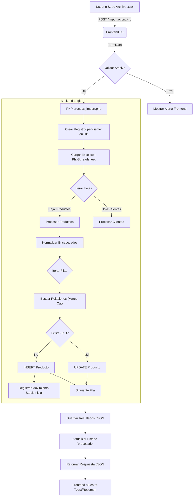

# Documentación del Módulo de Importación Masiva

Este documento detalla el funcionamiento técnico del sistema de importación masiva en BuzzDM, diseñado para cargar y actualizar Productos, Clientes y Proveedores mediante archivos Excel (.xlsx).

## Tecnologías Utilizadas

*   **Lenguaje:** PHP 8.x
*   **Librería Principal:** `PhpOffice\PhpSpreadsheet`
    *   Utilizada para leer y escribir archivos Excel con precisión.
    *   Permite iterar filas y celdas de manera eficiente.
*   **Base de Datos:** MySQL / MariaDB (InnoDB)
*   **Frontend:** JavaScript (Fetch API) para cargas asíncronas y feedback en tiempo real.

## Tablas de Base de Datos Involucradas

El proceso interactúa principalmente con la tabla `importaciones` para auditoría y luego con las tablas destino según la hoja del Excel.

### 1. Control de Importaciones (`importaciones`)
Registra cada intento de carga para historial y auditoría.

```sql
CREATE TABLE importaciones (
  id INT UNSIGNED AUTO_INCREMENT PRIMARY KEY,
  usuario_id INT UNSIGNED NULL, -- Quién realizó la carga
  tipo VARCHAR(50) NOT NULL, -- 'general' (soporta múltiples entidades)
  archivo_nombre VARCHAR(255) NULL,
  fecha TIMESTAMP DEFAULT CURRENT_TIMESTAMP,
  estado ENUM('pendiente','procesado','error') DEFAULT 'pendiente',
  detalles TEXT NULL, -- JSON con resultados (insertados, errores, etc.)
  FOREIGN KEY (usuario_id) REFERENCES usuarios(id)
);
```

### 2. Tablas Destino (Entidades)
*   **Productos (`productos`):** Se insertan o actualizan productos.
    *   *Relacionadas:* `categorias`, `marcas`, `proveedores` (se crean automáticamente si no existen durante la importación).
    *   *Inventario:* Si se especifica stock inicial en un producto nuevo, se inserta un registro en `movimientos_inventario`.
*   **Clientes (`clientes`):** Importación de cartera de clientes.
*   **Proveedores (`proveedores`):** Registro de proveedores.

## Flujo de Proceso

El sistema sigue un patrón ETL (Extract, Transform, Load) simplificado.



## Análisis de Código Clave

### 1. Normalización de Encabezados
Para evitar errores por mayúsculas o espacios en el Excel, normalizamos las claves antes de mapear.

```php
// process_import.php
function normalizeKey($key) {
    // Ejemplo: "Precio Venta" -> "precioventa"
    return strtolower(trim(preg_replace('/[\x00-\x1F\x7F]/', '', $key)));
}
```

### 2. Lógica "Find or Create" (Relaciones)
Permite que el usuario escriba una marca o categoría nueva en el Excel y el sistema la cree al vuelo sin error.

```php
// process_import.php
function findOrCreate(PDO $pdo, string $tableName, ?string $name): ?int {
    // 1. Buscar si existe
    $stmt = $pdo->prepare("SELECT id FROM {$tableName} WHERE LOWER(nombre) = LOWER(?) LIMIT 1");
    // ...
    // 2. Si no existe, insertar
    $stmt = $pdo->prepare("INSERT INTO {$tableName} (nombre) VALUES (?)");
    $stmt->execute([$name]);
    return (int)$pdo->lastInsertId();
}
```

### 3. Mapeo Dinámico
El sistema utiliza un array de configuración `$mappings` para definir qué columnas del Excel corresponden a qué campos de la DB.

```php
$mappings = [
    'Productos' => [
        'sheet_names' => ['Productos', 'products'], // Hojas aceptadas
        'table' => 'productos',
        'unique_key' => 'sku', // Campo clave para decidir Insert vs Update
        'columns' => [
            'sku' => ['db' => 'sku', 'required' => true],
            'nombreproducto' => ['db' => 'nombre', 'required' => true],
            'marca' => ['db' => 'marca_id', 'type' => 'fk', 'table' => 'marcas'],
            // ...
        ]
    ]
];
```

### 4. Generación de Plantilla (`download_template.php`)
Utiliza `PhpSpreadsheet` para crear un archivo .xlsx "al vuelo" con todas las hojas y encabezados requeridos, asegurando que el usuario tenga el formato correcto.

```php
// download_template.php
$spreadsheet = new Spreadsheet();
// ...
foreach ($templates as $sheetName => $headers) {
    // Crear hoja y definir encabezados
    $sheet->fromArray($headers, NULL, 'A1');
    // Estilizar encabezados (Negrita, Color)
    $sheet->getStyle('A1:' . $lastCol . '1')->getFont()->setBold(true);
}
// Forzar descarga
header('Content-Type: application/vnd.openxmlformats-officedocument.spreadsheetml.sheet');
$writer->save('php://output');
```

## Manejo de Errores y Transacciones
*   **Transacciones Atómicas:** Se utiliza `$pdo->beginTransaction()` por hoja. Si ocurre un error fatal en una hoja, se hace `rollBack()` para evitar datos corruptos.
*   **Errores por Fila:** Si una fila individual falla (ej. falta campo obligatorio), se registra en el array `$stats['errors']` y se continúa con la siguiente (Skip logic), permitiendo una carga parcial útil.
*   **Resultados:** Al finalizar, el campo `importaciones.detalles` almacena un JSON con el conteo de insertados, actualizados y lista de errores específicos.
