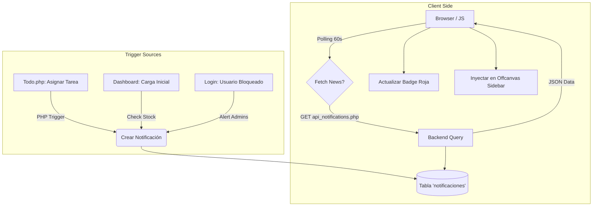

# Documentación del Hub de Notificaciones

Este documento detalla la arquitectura, funcionamiento e implementación del **Sistema Centralizado de Notificaciones** en BuzzDM.

## Tecnologías y Estructura

*   **Backend:** PHP (API REST + Funciones Helper)
*   **Base de Datos:** MySQL / MariaDB (Tabla `notificaciones`)
*   **Frontend:** JavaScript Puro (Polling + DOM Manipulation)
*   **Diseño:** CSS3 (Animaciones, Glassmorphism, Offcanvas)

## 1. Arquitectura de Base de Datos

Todas las notificaciones se almacenan en una única tabla relacional.

```sql
CREATE TABLE IF NOT EXISTS notificaciones (
    id INT UNSIGNED AUTO_INCREMENT PRIMARY KEY,
    usuario_id INT(10) UNSIGNED NOT NULL,
    tipo ENUM('info', 'success', 'warning', 'error', 'task_assign', 'low_stock', 'security') DEFAULT 'info',
    titulo VARCHAR(100) NOT NULL,
    mensaje TEXT NOT NULL,
    enlace VARCHAR(255) NULL,
    leido TINYINT(1) DEFAULT 0,
    creado_at DATETIME DEFAULT CURRENT_TIMESTAMP,
    FOREIGN KEY (usuario_id) REFERENCES usuarios(id) ON DELETE CASCADE
);
```

### Tipos de Notificación
*   `info`, `success`, `warning`, `error`: Mensajes genéricos del sistema.
*   `task_assign`: Cuando se asigna una tarea a un usuario.
*   `low_stock`: Alerta de inventario crítico (Admin/Supervisor).
*   `security`: Alerta de seguridad crítica (ej. usuario bloqueado).

## 2. Flujo de Funcionamiento

El sistema funciona mediante un modelo de **Pull (Polling)** desde el cliente, alimentado por eventos **Push (Triggers)** en el backend.



## 3. Implementación de Código

### A. Función Helper (`php/notification_functions.php`)
Esta función reutilizable permite generar notificaciones desde cualquier punto del sistema.

```php
function createNotification($conn, $userId, $type, $title, $message, $link = null) {
    // ... Logica de detección de conexión (PDO/MySQLi)
    $stmt = $conn->prepare("INSERT INTO notificaciones ... VALUES (?, ?, ?, ?, ?, NOW())");
    $stmt->execute([...]);
}
```

### B. API Backend (`php/api_notifications.php`)
Maneja las peticiones AJAX del frontend.

*   **GET `?action=fetch`**: Devuelve conteo de no leídas y lista de notificaciones recientes.
*   **POST `action=mark_read`**: Marca una o todas como leídas.
*   **POST `action=delete`**: Elimina historial.

### C. Lógica Frontend (`assets/js/notifications.js`)
*   **Inyección UI**: Crea dinámicamente el botón de campana en el navbar si no existe.
*   **Polling**: Ejecuta `fetchNotifications()` cada 60 segundos.
*   **Offcanvas**: Gestiona la apertura/cierre del panel lateral y renderiza HTML.

## 4. Triggers Implementados

### Trig 1: Asignación de Tareas
**Archivo:** `php/notas_actions.php`
Cuando se crea o edita una nota tipo Kanban y se asignan `miembros`:

```php
// Si el usuario asignado NO es el usuario actual
if ($memberId != $_SESSION['usuario_id']) {
    createNotification(
        $pdo,
        $memberId,
        'task_assign',
        'Nueva Tarea Asignada',
        'Te han asignado la tarea: ' . $input['titulo'],
        'todo.php?id=' . $notaId
    );
}
```

### Trig 2: Alerta de Stock Bajo
**Archivo:** `php/check_alerts.php`
Se incluye en `dashboard.php`. Verifica una vez al día (por sesión) si hay productos con stock cero o crítico.

```php
// Solo Admin/Supervisores
if ($lowCount > 0) {
    createNotification($pdo, $userId, 'low_stock', 'Stock Crítico', "Hay $lowCount productos...", 'inventario.php');
}
```

### Trig 3: Alerta de Seguridad (Baneo)
**Archivo:** `php/login_guard.php`
Si un usuario falla 10 veces la contraseña y es bloqueado, se avisa a todos los administradores.

```php
if ($new_attempts >= 10) {
    // ... Bloquear usuario ...
    $stmtAdmins = $pdo->query("SELECT id FROM usuarios WHERE rol = 'admin'");
    while ($admin = $stmtAdmins->fetch()) {
        createNotification($pdo, $admin['id'], 'security', 'Usuario Bloqueado', "Usuario $email bloqueado...", ...);
    }
}
```
