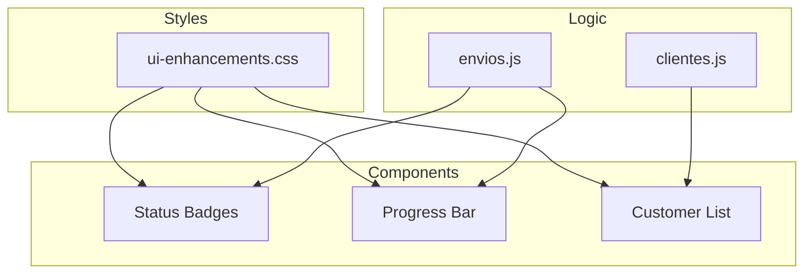
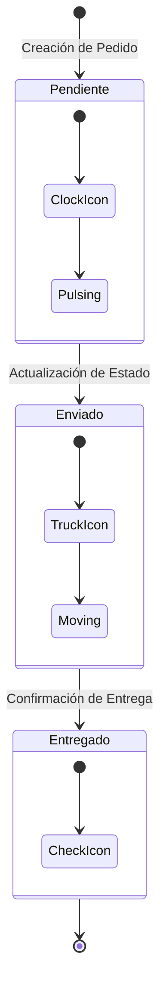

# Mejoras de Interfaz de Usuario

## Arquitectura de Componentes UI



---

## Status Badges (Envíos)

### Ciclo de Vida del Envío


---

## Status Badges (Envíos)

Badges visuales para estados de envío con iconos animados.

### Clases CSS

```html
<!-- Pendiente (amarillo, icono pulsante) -->
<div class="status-badge status-pendiente">
    <i class="fas fa-clock"></i> PENDIENTE
</div>

<!-- Enviado (azul, camión animado) -->
<div class="status-badge status-enviado">
    <i class="fas fa-truck"></i> ENVIADO
</div>

<!-- Entregado (verde, check) -->
<div class="status-badge status-entregado">
    <i class="fas fa-check-circle"></i> ENTREGADO
</div>
```

### Características
- Texto en mayúsculas con espaciado
- Iconos con animaciones sutiles
- Colores temáticos (amarillo/azul/verde)
- Bordes con color de acento

---

## Progress Bar Personalizado

Barra de progreso con gradiente y efecto shimmer.

```html
<div class="progress-buzz">
    <div class="progress-buzz-bar" style="width: 50%"></div>
</div>
<div class="progress-text">
    <i class="fas fa-truck"></i>
    <span>En camino...</span>
</div>
```

### Características
- Gradiente con color primario
- Animación shimmer continua
- Texto descriptivo con icono
- Transiciones suaves

---

## Lista de Clientes Frecuentes

Diseño personalizado para la sección de clientes frecuentes.

```html
<div class="frequent-customer-item">
    <span class="frequent-customer-name">Nombre Cliente</span>
    <span class="frequent-customer-orders">5 pedidos</span>
</div>
```

### Características
- Borde izquierdo de acento
- Efecto hover interactivo
- Fuente monospace para nombres
- Contador de pedidos destacado
- Scrollbar personalizado

---

## Animaciones CSS

```css
/* Pulso para estado pendiente */
@keyframes pulse-warning {
    0%, 100% { opacity: 1; }
    50% { opacity: 0.5; }
}

/* Movimiento de camión */
@keyframes truck-move {
    0%, 100% { transform: translateX(0); }
    50% { transform: translateX(3px); }
}

/* Shimmer en progress bar */
@keyframes shimmer {
    0% { background-position: -200% 0; }
    100% { background-position: 200% 0; }
}
```

---

## Clases Adicionales

| Clase | Uso |
|-------|-----|
| `.tracking-badge` | Número de seguimiento |
| `.status-icon` | Iconos circulares de estado |
| `.frequent-customer-item` | Item de lista de clientes |
| `.progress-buzz` | Contenedor de progress bar |

---

## Principios de Diseño

- ✅ Consistente con tema hexagon black ops
- ✅ Usa variables CSS del programa (`--buzz-primary-color`)
- ✅ Modo oscuro
- ✅ Animaciones sutiles y performantes
- ✅ Diseño responsive
- ✅ 60fps (usando CSS transforms)

---

## Páginas Que Usan Estos Estilos

- `clientes.php` - Lista de clientes frecuentes
- `envios.php` - Status badges y progress bar

---

**Versión:** 1.0 | **Diciembre 2025**
