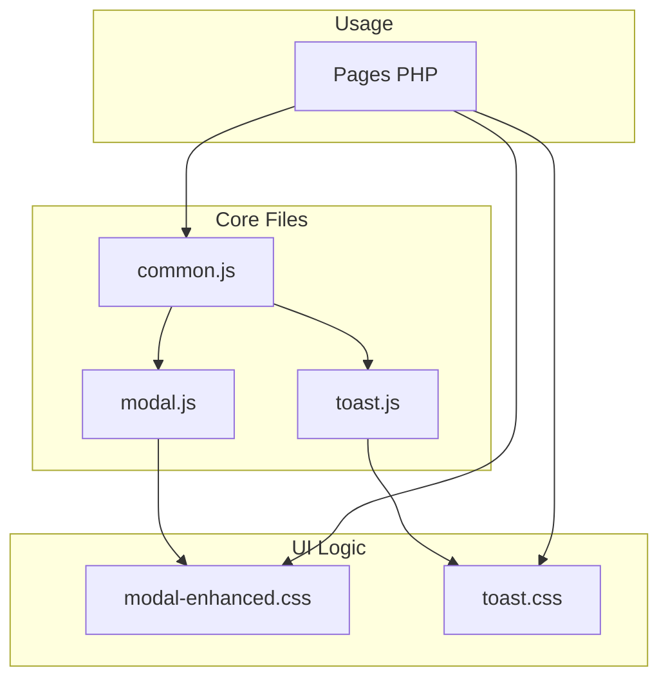
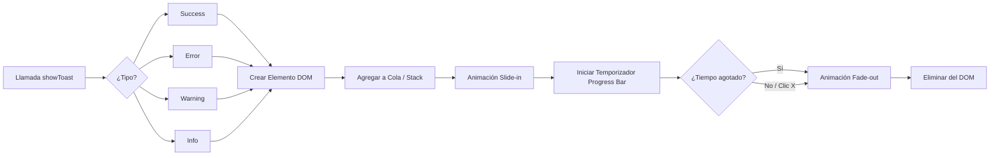

# Sistema de Modales y Toasts

## Arquitectura del Sistema



## Sistema Modal-Buzz

### Abrir/Cerrar Modales

```javascript
// Abrir modal
openModal('productModal');

// Cerrar modal
closeModal('productModal');

// Cerrar con callback
closeModal('productModal', function() {
    console.log('Modal cerrado');
});
```

### Estados de Carga

```javascript
// Mostrar loading
showModalLoading('productModal', 'Guardando...');

// Ocultar loading
hideModalLoading('productModal');
```

### Estructura HTML

```html
<div class="modal-buzz" id="myModal">
    <div class="modal-content-buzz">
        <div class="modal-header-buzz">
            <h5><i class="fas fa-box"></i> Título</h5>
            <button class="close-buzz" onclick="closeModal('myModal')">&times;</button>
        </div>
        <div class="modal-body-buzz">
            <!-- Sección con icono -->
            <div class="modal-section">
                <div class="modal-section-title">
                    <i class="fas fa-info-circle"></i> INFORMACIÓN
                </div>
                <!-- Contenido -->
            </div>
        </div>
        <div class="modal-footer-buzz">
            <button class="btn btn-outline-buzz" onclick="closeModal('myModal')">
                Cancelar
            </button>
            <button class="btn btn-buzz">
                <i class="fas fa-save"></i> Guardar
            </button>
        </div>
    </div>
</div>
```

### Tamaños de Modal

```html
<!-- Default (max-width: 700px) -->
<div class="modal-content-buzz">

<!-- Large (max-width: 900px) -->
<div class="modal-content-buzz modal-lg">

<!-- Extra Large (max-width: 1140px) -->
<div class="modal-content-buzz modal-xl">
```

---

## Sistema de Toasts

### Flujo de Notificación


### Notificaciones Rápidas

```javascript
// Éxito (verde)
showToast("Producto guardado", "success");

// Error (rojo)
showToast("No se pudo guardar", "error");

// Advertencia (amarillo)
showToast("Stock bajo", "warning");

// Información (naranja)
showToast("Procesando...", "info");

// Con duración personalizada (5 segundos)
showToast("Mensaje", "success", 5000);
```

### Diálogos de Confirmación

```javascript
// Modal informativo
showModal({
    title: "Información",
    message: "Este es un mensaje informativo",
    type: "info"
});

// Modal de confirmación
showModal({
    title: "Confirmar Acción",
    message: "¿Estás seguro?",
    type: "confirm",
    onConfirm: () => {
        // Acción al confirmar
    }
});

// Modal de error
showModal({
    title: "Error",
    message: "Algo salió mal",
    type: "error"
});
```

---

## Migración de alert()/confirm()

### ❌ No usar:
```javascript
alert("Guardado exitosamente");
if (confirm("¿Eliminar?")) { ... }
```

### ✅ Usar:
```javascript
showToast("Guardado exitosamente", "success");

showModal({
    title: "Confirmar Eliminación",
    message: "¿Eliminar este elemento?",
    type: "confirm",
    onConfirm: () => { /* eliminar */ }
});
```

---

## Ejemplo: Formulario con Loading y Toast

```javascript
document.getElementById('myForm').addEventListener('submit', async function(e) {
    e.preventDefault();

    showModalLoading('myModal', 'Guardando...');

    try {
        const response = await fetch('php/save.php', {
            method: 'POST',
            body: new FormData(this)
        });
        const data = await response.json();

        if (data.success) {
            showToast('Guardado correctamente', 'success');
            closeModal('myModal');
        } else {
            showToast(data.message || 'Error al guardar', 'error');
        }
    } catch (error) {
        showToast('Error de conexión', 'error');
    } finally {
        hideModalLoading('myModal');
    }
});
```

---

## Atajos de Teclado

- **ESC**: Cerrar modal
- **Tab**: Navegar campos
- **Enter**: Enviar formulario

---

## Características

- ✅ Sin animaciones (rendimiento óptimo)
- ✅ Glassmorphism sutil
- ✅ Tema oscuro
- ✅ Auto-dismiss con barra de progreso
- ✅ Cola de múltiples toasts
- ✅ Click fuera para cerrar
- ✅ Responsive/Mobile

---

**Versión:** 1.0 | **Diciembre 2025**
