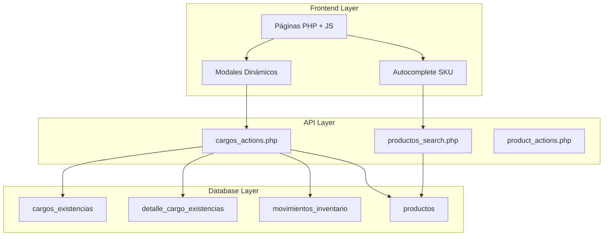
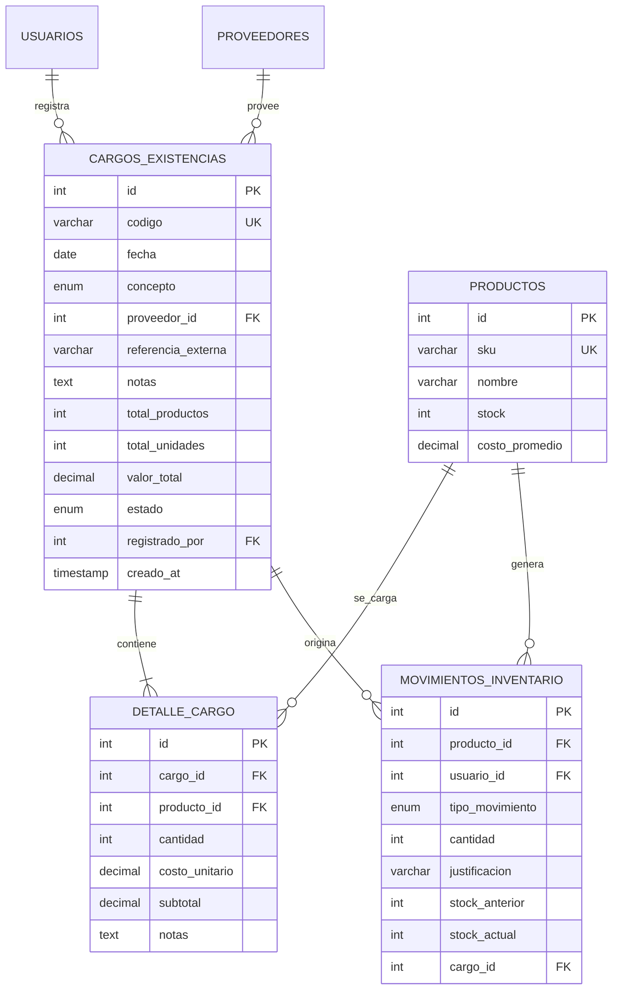
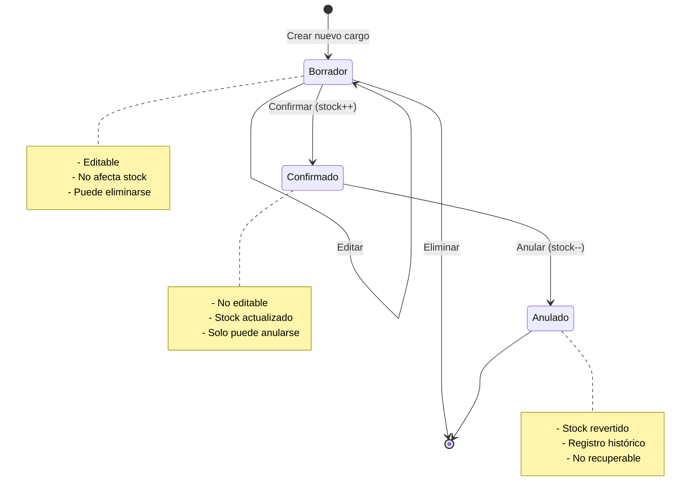

# 📦 Plan de Implementación: Sistema de Inventario Empresarial BuzzDM

## Descripción General

Este documento detalla el plan de implementación para añadir capacidades de inventario empresarial a BuzzDM, comenzando con el **Sistema de Cargos de Existencias** como módulo prioritario.

> [!IMPORTANT]
> Los scripts SQL están diseñados para ejecutarse en secuencia. Ejecuta cada fase antes de pasar a la siguiente.

---

## Arquitectura del Sistema



---

# FASE 1: Sistema de Cargos de Existencias

## 1.1 Modelo de Datos

### Diagrama Entidad-Relación



---

## 1.2 Script SQL - Fase 1

> [!CAUTION]
> Ejecuta este script en tu base de datos `dbuzz` ANTES de implementar el código.

```sql
-- =====================================================
-- FASE 1: SISTEMA DE CARGOS DE EXISTENCIAS
-- Ejecutar en: dbuzz
-- Fecha: 2026-01-05
-- =====================================================

-- 1. Tabla principal de Cargos de Existencias
DROP TABLE IF EXISTS `detalle_cargo_existencias`;
DROP TABLE IF EXISTS `cargos_existencias`;

CREATE TABLE `cargos_existencias` (
    `id` INT UNSIGNED NOT NULL AUTO_INCREMENT,
    `codigo` VARCHAR(20) NOT NULL COMMENT 'Formato: CGO-YYYY-NNNN',
    `fecha` DATE NOT NULL,
    `concepto` ENUM(
        'compra',
        'donacion',
        'ajuste_positivo',
        'devolucion_cliente',
        'inventario_inicial',
        'otro'
    ) NOT NULL DEFAULT 'compra',
    `concepto_otro` VARCHAR(100) DEFAULT NULL COMMENT 'Descripción si concepto=otro',
    `proveedor_id` INT DEFAULT NULL,
    `referencia_externa` VARCHAR(100) DEFAULT NULL COMMENT 'Nro. Factura, Guía, etc.',
    `notas` TEXT DEFAULT NULL,
    `total_productos` INT UNSIGNED DEFAULT 0 COMMENT 'Cantidad de líneas/productos distintos',
    `total_unidades` INT UNSIGNED DEFAULT 0 COMMENT 'Suma de todas las cantidades',
    `valor_total` DECIMAL(14,2) DEFAULT 0.00 COMMENT 'Suma de subtotales',
    `estado` ENUM('borrador', 'confirmado', 'anulado') NOT NULL DEFAULT 'borrador',
    `registrado_por` INT UNSIGNED NOT NULL COMMENT 'Usuario que creó el cargo',
    `confirmado_por` INT UNSIGNED DEFAULT NULL,
    `fecha_confirmacion` TIMESTAMP NULL DEFAULT NULL,
    `anulado_por` INT UNSIGNED DEFAULT NULL,
    `fecha_anulacion` TIMESTAMP NULL DEFAULT NULL,
    `motivo_anulacion` VARCHAR(255) DEFAULT NULL,
    `creado_at` TIMESTAMP NOT NULL DEFAULT CURRENT_TIMESTAMP,
    `actualizado_at` TIMESTAMP NULL DEFAULT NULL ON UPDATE CURRENT_TIMESTAMP,
    PRIMARY KEY (`id`),
    UNIQUE KEY `uk_codigo` (`codigo`),
    KEY `idx_fecha` (`fecha`),
    KEY `idx_estado` (`estado`),
    KEY `idx_concepto` (`concepto`),
    KEY `fk_cargo_proveedor` (`proveedor_id`),
    KEY `fk_cargo_registrado` (`registrado_por`),
    CONSTRAINT `fk_cargo_proveedor` FOREIGN KEY (`proveedor_id`)
        REFERENCES `proveedores` (`id`) ON DELETE SET NULL ON UPDATE CASCADE,
    CONSTRAINT `fk_cargo_registrado` FOREIGN KEY (`registrado_por`)
        REFERENCES `usuarios` (`id`) ON DELETE RESTRICT ON UPDATE CASCADE,
    CONSTRAINT `fk_cargo_confirmado` FOREIGN KEY (`confirmado_por`)
        REFERENCES `usuarios` (`id`) ON DELETE SET NULL ON UPDATE CASCADE,
    CONSTRAINT `fk_cargo_anulado` FOREIGN KEY (`anulado_por`)
        REFERENCES `usuarios` (`id`) ON DELETE SET NULL ON UPDATE CASCADE
) ENGINE=InnoDB DEFAULT CHARSET=utf8mb4 COLLATE=utf8mb4_unicode_ci
COMMENT='Encabezado de cargos masivos de existencias';

-- 2. Tabla de detalle (líneas del cargo)
CREATE TABLE `detalle_cargo_existencias` (
    `id` INT UNSIGNED NOT NULL AUTO_INCREMENT,
    `cargo_id` INT UNSIGNED NOT NULL,
    `producto_id` INT UNSIGNED NOT NULL,
    `cantidad` INT UNSIGNED NOT NULL DEFAULT 1,
    `costo_unitario` DECIMAL(12,2) NOT NULL DEFAULT 0.00,
    `subtotal` DECIMAL(14,2) GENERATED ALWAYS AS (`cantidad` * `costo_unitario`) STORED,
    `notas` VARCHAR(255) DEFAULT NULL,
    PRIMARY KEY (`id`),
    KEY `idx_cargo` (`cargo_id`),
    KEY `idx_producto` (`producto_id`),
    UNIQUE KEY `uk_cargo_producto` (`cargo_id`, `producto_id`) COMMENT 'Un producto solo una vez por cargo',
    CONSTRAINT `fk_detalle_cargo` FOREIGN KEY (`cargo_id`)
        REFERENCES `cargos_existencias` (`id`) ON DELETE CASCADE ON UPDATE CASCADE,
    CONSTRAINT `fk_detalle_producto` FOREIGN KEY (`producto_id`)
        REFERENCES `productos` (`id`) ON DELETE RESTRICT ON UPDATE CASCADE
) ENGINE=InnoDB DEFAULT CHARSET=utf8mb4 COLLATE=utf8mb4_unicode_ci
COMMENT='Líneas de productos en cada cargo';

-- 3. Modificar tabla movimientos_inventario para enlazar con cargos
ALTER TABLE `movimientos_inventario`
    ADD COLUMN `cargo_id` INT UNSIGNED DEFAULT NULL AFTER `justificacion`,
    ADD CONSTRAINT `fk_mov_cargo` FOREIGN KEY (`cargo_id`)
        REFERENCES `cargos_existencias` (`id`) ON DELETE SET NULL ON UPDATE CASCADE;

-- 4. Agregar campos de costeo a productos (si no existen)
ALTER TABLE `productos`
    ADD COLUMN IF NOT EXISTS `costo_promedio` DECIMAL(12,4) DEFAULT 0.0000 AFTER `precio`,
    ADD COLUMN IF NOT EXISTS `costo_ultimo` DECIMAL(12,4) DEFAULT 0.0000 AFTER `costo_promedio`;

-- 5. Función para generar código de cargo automático
DROP FUNCTION IF EXISTS `fn_generar_codigo_cargo`;
DELIMITER //
CREATE FUNCTION `fn_generar_codigo_cargo`()
RETURNS VARCHAR(20)
DETERMINISTIC
BEGIN
    DECLARE v_year CHAR(4);
    DECLARE v_next_num INT;
    DECLARE v_codigo VARCHAR(20);

    SET v_year = YEAR(CURDATE());

    SELECT COALESCE(MAX(
        CAST(SUBSTRING(codigo, 10) AS UNSIGNED)
    ), 0) + 1
    INTO v_next_num
    FROM cargos_existencias
    WHERE codigo LIKE CONCAT('CGO-', v_year, '-%');

    SET v_codigo = CONCAT('CGO-', v_year, '-', LPAD(v_next_num, 4, '0'));

    RETURN v_codigo;
END //
DELIMITER ;

-- 6. Trigger para actualizar stock al confirmar cargo
DROP TRIGGER IF EXISTS `trg_cargo_confirmado`;
DELIMITER //
CREATE TRIGGER `trg_cargo_confirmado`
AFTER UPDATE ON `cargos_existencias`
FOR EACH ROW
BEGIN
    -- Solo cuando cambia a 'confirmado'
    IF NEW.estado = 'confirmado' AND OLD.estado = 'borrador' THEN
        -- Actualizar stock de cada producto
        UPDATE productos p
        INNER JOIN detalle_cargo_existencias d ON p.id = d.producto_id
        SET p.stock = p.stock + d.cantidad,
            p.costo_ultimo = d.costo_unitario,
            p.actualizado_at = NOW()
        WHERE d.cargo_id = NEW.id;

        -- Registrar movimientos de inventario
        INSERT INTO movimientos_inventario
            (producto_id, usuario_id, tipo_movimiento, cantidad,
             justificacion, stock_anterior, stock_actual, cargo_id)
        SELECT
            d.producto_id,
            NEW.confirmado_por,
            'entrada',
            d.cantidad,
            CONCAT('Cargo ', NEW.codigo, ' - ', NEW.concepto),
            p.stock - d.cantidad,
            p.stock,
            NEW.id
        FROM detalle_cargo_existencias d
        INNER JOIN productos p ON p.id = d.producto_id
        WHERE d.cargo_id = NEW.id;
    END IF;
END //
DELIMITER ;

-- 7. Vista para consultar cargos con resumen
DROP VIEW IF EXISTS `v_cargos_resumen`;
CREATE VIEW `v_cargos_resumen` AS
SELECT
    c.id,
    c.codigo,
    c.fecha,
    c.concepto,
    CASE c.concepto
        WHEN 'compra' THEN 'Compra'
        WHEN 'donacion' THEN 'Donación'
        WHEN 'ajuste_positivo' THEN 'Ajuste Positivo'
        WHEN 'devolucion_cliente' THEN 'Devolución Cliente'
        WHEN 'inventario_inicial' THEN 'Inventario Inicial'
        WHEN 'otro' THEN COALESCE(c.concepto_otro, 'Otro')
    END AS concepto_texto,
    p.nombre AS proveedor_nombre,
    c.referencia_externa,
    c.total_productos,
    c.total_unidades,
    c.valor_total,
    c.estado,
    u.nombre AS registrado_por_nombre,
    c.creado_at,
    uc.nombre AS confirmado_por_nombre,
    c.fecha_confirmacion
FROM cargos_existencias c
LEFT JOIN proveedores p ON c.proveedor_id = p.id
LEFT JOIN usuarios u ON c.registrado_por = u.id
LEFT JOIN usuarios uc ON c.confirmado_por = uc.id
ORDER BY c.creado_at DESC;

-- 8. Índice para búsqueda rápida de productos
ALTER TABLE `productos`
    ADD FULLTEXT INDEX IF NOT EXISTS `ft_productos_busqueda` (`sku`, `nombre`);
```

---

## 1.3 Flujo del Proceso de Carga

```mermaid
flowchart TD
    A[Usuario abre Cargar Existencias] --> B[Sistema genera código CGO-YYYY-NNNN]
    B --> C[Usuario ingresa información del cargo]
    C --> D{¿Tiene productos?}
    D -->|No| E[Agregar línea de producto]
    E --> F[Buscar producto por SKU]
    F --> G[Autocomplete muestra coincidencias]
    G --> H[Usuario selecciona producto]
    H --> I[Sistema muestra nombre del producto]
    I --> J[Usuario ingresa cantidad y costo]
    J --> K[Sistema calcula subtotal]
    K --> L{¿Agregar más productos?}
    L -->|Sí| E
    L -->|No| M[Sistema muestra resumen total]
    D -->|Sí| M
    M --> N{¿Guardar como?}
    N -->|Borrador| O[Guardar estado=borrador]
    N -->|Confirmar| P[Validar datos completos]
    P --> Q{¿Datos válidos?}
    Q -->|No| R[Mostrar errores]
    R --> C
    Q -->|Sí| S[Guardar estado=confirmado]
    S --> T[Trigger actualiza stock automáticamente]
    T --> U[Registrar movimientos de inventario]
    U --> V[Mostrar confirmación]
    O --> W[Cargo guardado como borrador]

    style A fill:#1a1a2e,stroke:#00ff88
    style S fill:#1a1a2e,stroke:#00ff88
    style T fill:#1a1a2e,stroke:#ffd700
    style U fill:#1a1a2e,stroke:#ffd700
```



---

## 1.4 Diagrama de Estados del Cargo



---

## 1.5 Estructura de Archivos a Crear

```
BuzzDM/
├── cargos_existencias.php          [NUEVO] Vista principal
├── assets/
│   ├── css/
│   │   └── cargos.css              [NUEVO] Estilos específicos
│   └── js/
│       └── cargos_existencias.js   [NUEVO] Lógica del formulario
├── php/
│   ├── cargos_actions.php          [NUEVO] API REST
│   └── productos_search.php        [NUEVO] Búsqueda autocomplete
└── db/
    └── fase1_cargos_existencias.sql [NUEVO] Script de esta fase
```

---

## 1.6 API Endpoints

| Método | Endpoint | Descripción |
|--------|----------|-------------|
| `GET` | `/php/cargos_actions.php` | Listar cargos con filtros |
| `GET` | `/php/cargos_actions.php?id=X` | Obtener cargo específico |
| `POST` | `/php/cargos_actions.php` | Crear nuevo cargo |
| `PUT` | `/php/cargos_actions.php?id=X` | Actualizar cargo (solo borrador) |
| `DELETE` | `/php/cargos_actions.php?id=X` | Eliminar cargo (solo borrador) |
| `POST` | `/php/cargos_actions.php?action=confirm&id=X` | Confirmar cargo |
| `POST` | `/php/cargos_actions.php?action=cancel&id=X` | Anular cargo |
| `GET` | `/php/productos_search.php?q=XXX` | Buscar productos por SKU/nombre |

---

## 1.7 Código Clave del Frontend

### Componente Autocomplete (cargos_existencias.js)

```javascript
// Búsqueda de productos con debounce
function debounce(func, wait) {
    let timeout;
    return function(...args) {
        clearTimeout(timeout);
        timeout = setTimeout(() => func.apply(this, args), wait);
    };
}

async function buscarProducto(query, resultsContainer, onSelect) {
    if (query.length < 2) {
        resultsContainer.innerHTML = '';
        resultsContainer.style.display = 'none';
        return;
    }

    try {
        const response = await fetch(`php/productos_search.php?q=${encodeURIComponent(query)}`);
        const data = await response.json();

        if (data.success && data.productos.length > 0) {
            resultsContainer.innerHTML = data.productos.map(p => `
                <div class="autocomplete-item"
                     data-id="${p.id}"
                     data-sku="${p.sku}"
                     data-nombre="${p.nombre}"
                     data-precio="${p.precio}">
                    <span class="ac-sku">${p.sku}</span>
                    <span class="ac-nombre">${p.nombre}</span>
                    <span class="ac-stock">Stock: ${p.stock}</span>
                </div>
            `).join('');
            resultsContainer.style.display = 'block';

            // Event listeners para cada item
            resultsContainer.querySelectorAll('.autocomplete-item').forEach(item => {
                item.addEventListener('click', () => {
                    onSelect({
                        id: item.dataset.id,
                        sku: item.dataset.sku,
                        nombre: item.dataset.nombre,
                        precio: parseFloat(item.dataset.precio)
                    });
                    resultsContainer.style.display = 'none';
                });
            });
        } else {
            resultsContainer.innerHTML = '<div class="autocomplete-empty">No se encontraron productos</div>';
            resultsContainer.style.display = 'block';
        }
    } catch (error) {
        console.error('Error buscando productos:', error);
    }
}
```

### Agregar Línea de Producto Dinámicamente

```javascript
let lineaIndex = 0;

function agregarLineaProducto(producto = null) {
    const container = document.getElementById('lineasProductosContainer');
    const lineaId = `linea-${lineaIndex++}`;

    const lineaHTML = `
        <div class="cargo-linea-row" id="${lineaId}" data-producto-id="${producto?.id || ''}">
            <div class="linea-sku-container">
                <input type="text"
                       class="form-control form-control-buzz sku-input"
                       placeholder="Buscar SKU..."
                       value="${producto?.sku || ''}"
                       ${producto ? 'readonly' : ''}>
                <div class="autocomplete-results"></div>
            </div>
            <div class="linea-nombre">
                <span class="nombre-display">${producto?.nombre || ''}</span>
            </div>
            <div class="linea-cantidad">
                <input type="number"
                       class="form-control form-control-buzz cantidad-input"
                       min="1"
                       value="1"
                       placeholder="Cant.">
            </div>
            <div class="linea-costo">
                <input type="number"
                       class="form-control form-control-buzz costo-input"
                       min="0"
                       step="0.01"
                       value="${producto?.precio || '0.00'}"
                       placeholder="Costo">
            </div>
            <div class="linea-subtotal">
                <span class="subtotal-display">$0.00</span>
            </div>
            <div class="linea-acciones">
                <button type="button" class="btn-action btn-delete" onclick="eliminarLinea('${lineaId}')">
                    <i class="fas fa-trash"></i>
                </button>
            </div>
        </div>
    `;

    container.insertAdjacentHTML('beforeend', lineaHTML);

    // Configurar autocomplete para la nueva línea
    const linea = document.getElementById(lineaId);
    const skuInput = linea.querySelector('.sku-input');
    const resultsContainer = linea.querySelector('.autocomplete-results');

    if (!producto) {
        skuInput.addEventListener('input', debounce((e) => {
            buscarProducto(e.target.value, resultsContainer, (prod) => {
                seleccionarProductoEnLinea(lineaId, prod);
            });
        }, 300));
    }

    // Listeners para calcular subtotal
    const cantidadInput = linea.querySelector('.cantidad-input');
    const costoInput = linea.querySelector('.costo-input');

    [cantidadInput, costoInput].forEach(input => {
        input.addEventListener('input', () => calcularSubtotal(lineaId));
    });

    calcularSubtotal(lineaId);
    actualizarTotales();
}

function seleccionarProductoEnLinea(lineaId, producto) {
    const linea = document.getElementById(lineaId);
    linea.dataset.productoId = producto.id;
    linea.querySelector('.sku-input').value = producto.sku;
    linea.querySelector('.sku-input').readOnly = true;
    linea.querySelector('.nombre-display').textContent = producto.nombre;
    linea.querySelector('.costo-input').value = producto.precio.toFixed(2);
    calcularSubtotal(lineaId);
}

function calcularSubtotal(lineaId) {
    const linea = document.getElementById(lineaId);
    const cantidad = parseFloat(linea.querySelector('.cantidad-input').value) || 0;
    const costo = parseFloat(linea.querySelector('.costo-input').value) || 0;
    const subtotal = cantidad * costo;
    linea.querySelector('.subtotal-display').textContent = `$${subtotal.toFixed(2)}`;
    actualizarTotales();
}

function actualizarTotales() {
    const lineas = document.querySelectorAll('.cargo-linea-row');
    let totalProductos = 0;
    let totalUnidades = 0;
    let valorTotal = 0;

    lineas.forEach(linea => {
        if (linea.dataset.productoId) {
            totalProductos++;
            const cantidad = parseFloat(linea.querySelector('.cantidad-input').value) || 0;
            const costo = parseFloat(linea.querySelector('.costo-input').value) || 0;
            totalUnidades += cantidad;
            valorTotal += cantidad * costo;
        }
    });

    document.getElementById('totalProductos').textContent = totalProductos;
    document.getElementById('totalUnidades').textContent = totalUnidades;
    document.getElementById('valorTotal').textContent = `$${valorTotal.toFixed(2)}`;
}
```

---

## 1.8 Código Clave del Backend

### productos_search.php

```php
<?php
require_once 'sesion.php';
require_once 'db.php';

header('Content-Type: application/json');

$query = $_GET['q'] ?? '';
$limit = intval($_GET['limit'] ?? 10);

if (strlen($query) < 2) {
    echo json_encode(['success' => false, 'message' => 'Query muy corta']);
    exit;
}

try {
    $pdo = getDBConnection();

    // Búsqueda por SKU exacto primero, luego por coincidencia parcial
    $sql = "SELECT id, sku, nombre, precio, stock
            FROM productos
            WHERE deleted_at IS NULL
              AND (sku LIKE :query_exact
                   OR sku LIKE :query_like
                   OR nombre LIKE :query_like)
            ORDER BY
                CASE WHEN sku = :query_raw THEN 0
                     WHEN sku LIKE :query_exact THEN 1
                     ELSE 2
                END,
                nombre ASC
            LIMIT :limit";

    $stmt = $pdo->prepare($sql);
    $stmt->bindValue(':query_raw', $query, PDO::PARAM_STR);
    $stmt->bindValue(':query_exact', $query . '%', PDO::PARAM_STR);
    $stmt->bindValue(':query_like', '%' . $query . '%', PDO::PARAM_STR);
    $stmt->bindValue(':limit', $limit, PDO::PARAM_INT);
    $stmt->execute();

    $productos = $stmt->fetchAll(PDO::FETCH_ASSOC);

    echo json_encode([
        'success' => true,
        'productos' => $productos
    ]);

} catch (Exception $e) {
    echo json_encode([
        'success' => false,
        'message' => 'Error en búsqueda: ' . $e->getMessage()
    ]);
}
```

### cargos_actions.php - Crear Cargo

```php
<?php
require_once 'sesion.php';
require_once 'db.php';

header('Content-Type: application/json');

// Verificar rol admin/supervisor
if (!in_array($_SESSION['usuario_rol'], ['admin', 'supervisor'])) {
    http_response_code(403);
    echo json_encode(['success' => false, 'message' => 'No autorizado']);
    exit;
}

$method = $_SERVER['REQUEST_METHOD'];
$pdo = getDBConnection();

switch ($method) {
    case 'POST':
        $input = json_decode(file_get_contents('php://input'), true);
        $action = $_GET['action'] ?? 'create';

        if ($action === 'create') {
            crearCargo($pdo, $input);
        } elseif ($action === 'confirm') {
            confirmarCargo($pdo, $_GET['id']);
        } elseif ($action === 'cancel') {
            anularCargo($pdo, $_GET['id'], $input['motivo'] ?? '');
        }
        break;
    // ... otros métodos
}

function crearCargo($pdo, $data) {
    try {
        $pdo->beginTransaction();

        // Generar código automático
        $codigo = $pdo->query("SELECT fn_generar_codigo_cargo()")->fetchColumn();

        // Insertar encabezado
        $sql = "INSERT INTO cargos_existencias
                (codigo, fecha, concepto, concepto_otro, proveedor_id,
                 referencia_externa, notas, registrado_por, estado)
                VALUES
                (:codigo, :fecha, :concepto, :concepto_otro, :proveedor_id,
                 :referencia, :notas, :usuario_id, :estado)";

        $stmt = $pdo->prepare($sql);
        $stmt->execute([
            ':codigo' => $codigo,
            ':fecha' => $data['fecha'],
            ':concepto' => $data['concepto'],
            ':concepto_otro' => $data['concepto_otro'] ?? null,
            ':proveedor_id' => $data['proveedor_id'] ?: null,
            ':referencia' => $data['referencia_externa'] ?? null,
            ':notas' => $data['notas'] ?? null,
            ':usuario_id' => $_SESSION['usuario_id'],
            ':estado' => $data['confirmar'] ? 'confirmado' : 'borrador'
        ]);

        $cargoId = $pdo->lastInsertId();

        // Insertar líneas de detalle
        $sqlDetalle = "INSERT INTO detalle_cargo_existencias
                       (cargo_id, producto_id, cantidad, costo_unitario, notas)
                       VALUES (:cargo_id, :producto_id, :cantidad, :costo, :notas)";
        $stmtDetalle = $pdo->prepare($sqlDetalle);

        $totalProductos = 0;
        $totalUnidades = 0;
        $valorTotal = 0;

        foreach ($data['lineas'] as $linea) {
            if (!$linea['producto_id'] || !$linea['cantidad']) continue;

            $stmtDetalle->execute([
                ':cargo_id' => $cargoId,
                ':producto_id' => $linea['producto_id'],
                ':cantidad' => $linea['cantidad'],
                ':costo' => $linea['costo_unitario'] ?? 0,
                ':notas' => $linea['notas'] ?? null
            ]);

            $totalProductos++;
            $totalUnidades += $linea['cantidad'];
            $valorTotal += $linea['cantidad'] * ($linea['costo_unitario'] ?? 0);
        }

        // Actualizar totales
        $pdo->prepare("UPDATE cargos_existencias
                       SET total_productos = ?, total_unidades = ?, valor_total = ?
                       WHERE id = ?")
            ->execute([$totalProductos, $totalUnidades, $valorTotal, $cargoId]);

        // Si se confirma directamente, actualizar confirmado_por
        if ($data['confirmar']) {
            $pdo->prepare("UPDATE cargos_existencias
                           SET confirmado_por = ?, fecha_confirmacion = NOW()
                           WHERE id = ?")
                ->execute([$_SESSION['usuario_id'], $cargoId]);
        }

        $pdo->commit();

        echo json_encode([
            'success' => true,
            'message' => $data['confirmar']
                ? 'Cargo confirmado y stock actualizado'
                : 'Cargo guardado como borrador',
            'cargo_id' => $cargoId,
            'codigo' => $codigo
        ]);

    } catch (Exception $e) {
        $pdo->rollBack();
        echo json_encode([
            'success' => false,
            'message' => 'Error al crear cargo: ' . $e->getMessage()
        ]);
    }
}
```

---

## 1.9 Mockup de la Interfaz

```
┌─────────────────────────────────────────────────────────────────────────┐
│ ☰  BUZZ Data Manager                                                     │
├─────────────────────────────────────────────────────────────────────────┤
│                                                                          │
│  CARGAR EXISTENCIAS / NUEVO CARGO                    [+ Nuevo Cargo]    │
│ ─────────────────────────────────────────────────────────────────────── │
│                                                                          │
│  ┌─ INFORMACIÓN DEL CARGO ──────────────────────────────────────────┐   │
│  │                                                                   │   │
│  │  Código: CGO-2026-0001 (auto)     Fecha: [📅 05/01/2026      ]   │   │
│  │                                                                   │   │
│  │  Concepto: [▼ Compra                              ]               │   │
│  │                                                                   │   │
│  │  Proveedor: [🔍 Buscar proveedor...              ]               │   │
│  │                                                                   │   │
│  │  Referencia/Factura: [                            ]               │   │
│  │                                                                   │   │
│  │  Notas: [                                                    ]   │   │
│  └───────────────────────────────────────────────────────────────────┘   │
│                                                                          │
│  ┌─ PRODUCTOS DEL CARGO ──────────────────────────── [+ Añadir Línea] ─┐ │
│  │                                                                      │ │
│  │  SKU/Código     │ Producto           │ Cantidad │ Costo   │Subtotal │ │
│  │  ───────────────┼────────────────────┼──────────┼─────────┼─────────│ │
│  │  [🔍 BK-001   ] │ Harry Potter       │ [  50  ] │[$8.50 ] │ $425.00 │ │
│  │  [🔍 BK-002   ] │ Don Quijote        │ [  30  ] │[$12.00] │ $360.00 │ │
│  │  [🔍 BK-003   ] │ Cien Años Soledad  │ [  25  ] │[$15.00] │ $375.00 │ │
│  │  [🔍          ] │                    │ [     ] │[$     ] │         │ │
│  └──────────────────────────────────────────────────────────────────────┘ │
│                                                                          │
│  ┌─ RESUMEN ────────────────────────────────────────────────────────┐   │
│  │                                                                   │   │
│  │   📦 Total Productos: 3    📊 Total Unidades: 105                │   │
│  │                                                                   │   │
│  │   💰 VALOR TOTAL: $1,160.00                                      │   │
│  │                                                                   │   │
│  └───────────────────────────────────────────────────────────────────┘   │
│                                                                          │
│  ┌───────────────────────────────────────────────────────────────────┐   │
│  │  [Cancelar]        [💾 Guardar Borrador]    [✓ Confirmar Cargo]  │   │
│  └───────────────────────────────────────────────────────────────────┘   │
│                                                                          │
└─────────────────────────────────────────────────────────────────────────┘
```

---

## 1.10 Modificación del Sidebar

```php
<!-- En php/sidebar.php - Reemplazar enlace de Inventario -->

<?php if ($usuarioRol === 'admin' || $usuarioRol === 'supervisor'): ?>
<li class="nav-item nav-dropdown">
    <a class="nav-link-enhanced nav-dropdown-toggle
       <?php echo in_array($currentPage, ['inventario.php', 'cargos_existencias.php']) ? 'active' : ''; ?>">
        <i class="fas fa-boxes nav-icon-enhanced"></i>
        <span class="nav-text-enhanced">Inventario</span>
        <i class="fas fa-chevron-down dropdown-arrow"></i>
    </a>
    <ul class="nav-dropdown-menu">
        <li>
            <a class="nav-dropdown-item <?php echo $currentPage === 'inventario.php' ? 'active' : ''; ?>"
               href="inventario.php">
                <i class="fas fa-box"></i> Productos
            </a>
        </li>
        <li>
            <a class="nav-dropdown-item <?php echo $currentPage === 'cargos_existencias.php' ? 'active' : ''; ?>"
               href="cargos_existencias.php">
                <i class="fas fa-dolly"></i> Cargar Existencias
            </a>
        </li>
    </ul>
</li>
<?php endif; ?>
```

---

## Verificación

### Pruebas Manuales

1. **Ejecutar script SQL**: Verificar que todas las tablas se creen correctamente
   - Ejecutar `fase1_cargos_existencias.sql` en phpMyAdmin o HeidiSQL
   - Verificar tablas: `cargos_existencias`, `detalle_cargo_existencias`
   - Verificar función: `fn_generar_codigo_cargo()`
   - Verificar trigger: `trg_cargo_confirmado`

2. **Probar búsqueda de productos**:
   - Navegar a `http://localhost/BuzzDM/php/productos_search.php?q=test`
   - Verificar respuesta JSON con productos coincidentes

3. **Crear cargo de prueba**:
   - Abrir `cargos_existencias.php`
   - Agregar 3 productos con cantidades
   - Guardar como borrador
   - Verificar en la tabla que estado = 'borrador'
   - Verificar que stock NO ha cambiado

4. **Confirmar cargo**:
   - Abrir cargo en borrador
   - Hacer clic en "Confirmar"
   - Verificar que estado = 'confirmado'
   - Verificar que stock de productos aumentó
   - Verificar registros en `movimientos_inventario`

---

# FASES SIGUIENTES (Resumen)

## Fase 2: Multi-Almacén
- Tablas: `almacenes`, `ubicaciones`, `stock_ubicacion`
- UI: Selector de almacén en cargos
- Reportes por almacén

## Fase 3: Gestión de Lotes
- Tabla: `lotes`
- UI: Asignar lote al cargar
- Alertas de expiración

## Fase 4: Transferencias y Conteos
- Tablas: `transferencias`, `conteos_inventario`
- UI: Módulos separados

## Fase 5: Alertas y Reportes
- Sistema de notificaciones
- Kardex, rotación, valorización

---

> [!NOTE]
> Este plan se enfoca en la Fase 1 completa. Las fases siguientes se detallarán después de implementar y validar la Fase 1.
