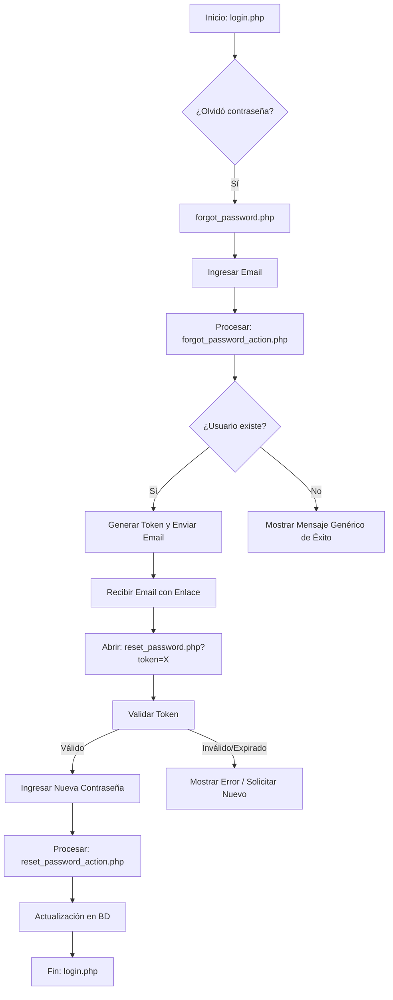
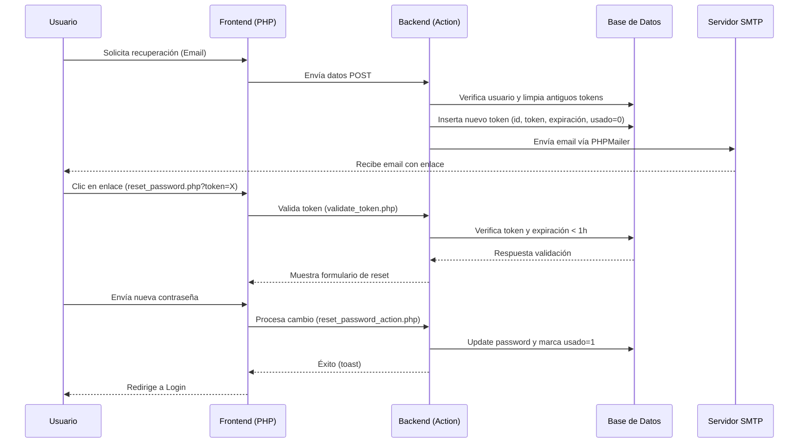

# Sistema de Recuperación de Contraseña

## Estructura de Archivos

```
BuzzDM/
├── forgot_password.php          # Formulario para solicitar recuperación
├── reset_password.php           # Formulario para nueva contraseña
└── php/
    ├── email_config.php             # ⚙️ Configuración SMTP (EDITAR)
    ├── forgot_password_action.php   # Procesa solicitud y envía email
    ├── validate_token.php           # Valida tokens de recuperación
    ├── reset_password_action.php    # Restablece la contraseña
    ├── cleanup_tokens.php           # Limpia tokens expirados, debe ser configurado con un cron probablemente
    └── verify_password_recovery.php # Script de verificación del sistema
```

---

## Configuración SMTP

### Método 1: Archivo `.env` (Recomendado)

1. Copia el archivo `env.example.txt` en la raíz del proyecto
2. Renómbralo a `.env`
3. Configura tus credenciales:

```ini
SMTP_HOST=smtp.gmail.com
SMTP_PORT=587
SMTP_SECURE=tls
SMTP_USERNAME=tu-email@gmail.com
SMTP_PASSWORD=xxxxxxxxxxxxxxxx
SMTP_FROM_EMAIL=tu-email@gmail.com
SMTP_FROM_NAME=BuzzDM
APP_BASE_URL=http://localhost/BuzzDM
```

### Método 2: Editar directamente `php/email_config.php`

Si no puedes crear un archivo `.env`, edita los valores por defecto en el archivo PHP.

### Obtener App Password de Gmail (en caso de utilizar gmail)
1. Ve a https://myaccount.google.com/security
2. Activa verificación en 2 pasos
3. Busca "Contraseñas de aplicaciones"
4. Genera contraseña para "Correo"

---

## Flujo del Sistema

### Proceso de Usuario


### Detalle Técnico (Secuencia)


---

## Seguridad

- ✅ Tokens únicos de 64 caracteres (SHA-256)
- ✅ Expiración automática (1 hora)
- ✅ Un solo uso por token
- ✅ No revela si email existe en BD
- ✅ Validación de contraseñas fuertes
- ✅ Logs de cambios de contraseña

---

## Instalación Rápida

```bash
# 1. Instalar PHPMailer
composer update

# 2. Verifica la existencia de la tabla para alamcenar tokens
# la base de datos deberia tener una tabla llamada:
password_reset_tokens

# 3. Configurar email
# Editar php/email_config.php

```

---

## Tabla: password_reset_tokens

| Campo | Tipo | Descripción |
|-------|------|-------------|
| id | int unsigned | ID autoincremental |
| usuario_id | int unsigned | FK a usuarios |
| token | char(64) | Token único |
| expiracion | timestamp | Expiración (1 hora) |
| usado | tinyint(1) | 0=disponible, 1=usado |
| creado_at | timestamp | Fecha creación |

---

## Producción

```php
// Cambiar URL base
define('APP_BASE_URL', 'https://tudominio.com');

// Configurar limpieza automática (cron)
0 2 * * * php /ruta/php/cleanup_tokens.php
```

---

**Implementado:** Noviembre 2025 | **Versión:** 1.0
