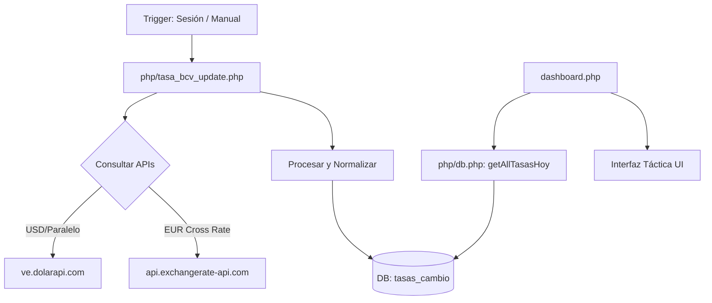

# Documentación Técnica: Monitor de Divisas Multi-Nodo (BuzzDM)

El Monitor de Divisas de BuzzDM es un sistema robusto de captura y visualización de datos financieros diseñado para proporcionar tasas de cambio en tiempo real (USD, EUR, USDT) con una estética táctica de alta densidad.

---

## 🚀 Arquitectura del Sistema

El sistema opera bajo un modelo de **captura asíncrona y visualización bajo demanda**, utilizando una base de datos centralizada para evitar latencia en la interfaz de usuario.

### Flujo de Datos

---

## 📡 Fuentes de Información (APIs)

El monitor utiliza múltiples nodos de datos para garantizar la redundancia y exactitud:

1.  **DolarApi (Principal)**:
    *   **Endpoint**: `https://ve.dolarapi.com/v1/dolares`
    *   **Uso**: Obtiene la tasa oficial del BCV y el promedio del Paralelo.
2.  **ExchangeRate-API (Secundaria)**:
    *   **Endpoint**: `https://api.exchangerate-api.com/v4/latest/USD`
    *   **Uso**: Proporciona la tasa de cruce internacional EUR/USD.
3.  **Lógica de Cálculo (EUR/USDT)**:
    *   **Euro**: Se calcula multiplicando `BCV_USD * (1 / USD_EUR_CROSS)`.
    *   **USDT**: Se estima basándose en el Paralelo con un ajuste de spread típico del mercado cripto.

---

## 📁 Archivos y Componentes

### Backend (PHP/Lógica)
*   **[php/tasa_bcv_update.php](file:///c:/xampp/htdocs/BuzzDM/php/tasa_bcv_update.php)**: El motor de sincronización. Maneja las peticiones cURL, el cálculo de tasas y la inserción transaccional en la BD. Incluye un sistema de *cooldown* de 4 horas para evitar bloqueos por parte de las APIs.
*   **[php/db.php](file:///c:/xampp/htdocs/BuzzDM/php/db.php)**: Contiene la función `getAllTasasHoy()`, que recupera todas las tasas disponibles para la fecha actual, con un *fallback* automático a la última fecha registrada si no hay datos de hoy.
*   **[php/backup_check.php](file:///c:/xampp/htdocs/BuzzDM/php/backup_check.php)**: Actúa como un "Cron" para pobres, disparando la actualización de tasas de forma asíncrona cuando un usuario inicia sesión.

### Frontend (UI/UX)
*   **[dashboard.php](file:///c:/xampp/htdocs/BuzzDM/dashboard.php)**: Estructura HTML que define el widget del monitor. Separa la "Lectura Principal" (BCV) de los "Nodos Secundarios" (Euro, USDT, Paralelo).
*   **[assets/js/dashboard.js](file:///c:/xampp/htdocs/BuzzDM/assets/js/dashboard.js)**: Maneja el botón de sincronización manual (`syncBcv()`), gestiona las animaciones de carga y muestra notificaciones visuales (Toasts).
*   **[assets/css/dashboard-effects.css](file:///c:/xampp/htdocs/BuzzDM/assets/css/dashboard-effects.css)**: Define los estilos tácticos, la rejilla de nodos (`.currency-grid`) y el efecto de brillo digital de la lectura principal.

---

## 🗄️ Estructura de Base de Datos

El sistema utiliza la tabla `tasas_cambio` con una restricción de unicidad compuesta:

| Columna | Tipo | Descripción |
| :--- | :--- | :--- |
| `id` | INT | Clave primaria. |
| `tasa` | DECIMAL | El valor de cambio en Bolívares. |
| `fuente` | VARCHAR | Identificador del nodo (bcv, bcv_euro, binance_usdt, paralelo). |
| `fecha` | DATE | Fecha de registro. |
| `creado_at` | TIMESTAMP | Marca de tiempo exacta de la última actualización. |

> [!IMPORTANT]
> Se utiliza una clave única compuesta `(fecha, fuente)` que permite almacenar múltiples tipos de moneda para un mismo día sin duplicados.

---

## 🛠️ Cómo Funciona la Sincronización

1.  **Automática**: Cada vez que un usuario entra al sistema, `sesion.php` verifica si han pasado más de 4 horas desde la última sincronización. Si es así, lanza un proceso en segundo plano.
2.  **Manual**: El usuario puede forzar la actualización pulsando el icono de sincronización en el dashboard. Esto activa `syncBcv()` en JS, que llama al script PHP y refresca la interfaz tras completar la operación.

---

*Documentación generada el 7 de enero de 2026 para el equipo de desarrollo de BuzzDM.*
